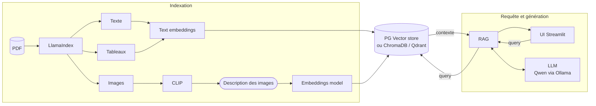

# Activité projet — Partie I : RAG multimodal agentique

Recopié du tableau (voir `étapes du projets à mettre dans un fichier md.jpeg`).

## Schéma d'architecture

## Étapes

1. **Choisir un fichier PDF** quelconque qui contient du texte, des images et des tableaux.
2. **Indexation du contenu**
   - Utiliser LlamaIndex pour parser le document PDF et extraire le texte, les images et les tableaux.
   - Vectoriser les contenus (embeddings) dans une base vectorielle : PG Vector store, ChromaDB ou Qdrant.
   - Pour avoir la description des images, utiliser le modèle CLIP.
   - Pour le modèle d'embeddings, utiliser un modèle open source.
3. **Query et génération** : créer la partie RAG en utilisant un LLM open source comme Qwen avec Ollama.
4. **Créer une interface Streamlit.**
5. **Rendre le RAG agentique avec LangChain.**

## Suivi

- [ ] 1. Choix du PDF
- [ ] 2. Indexation (LlamaIndex, CLIP, embeddings, base vectorielle)
- [ ] 3. RAG avec Qwen / Ollama
- [ ] 4. Interface Streamlit
- [ ] 5. Agent LangChain
